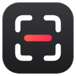
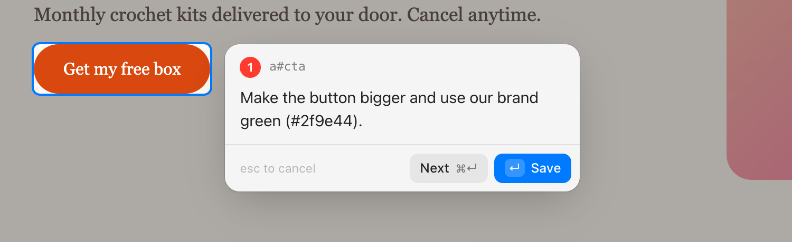
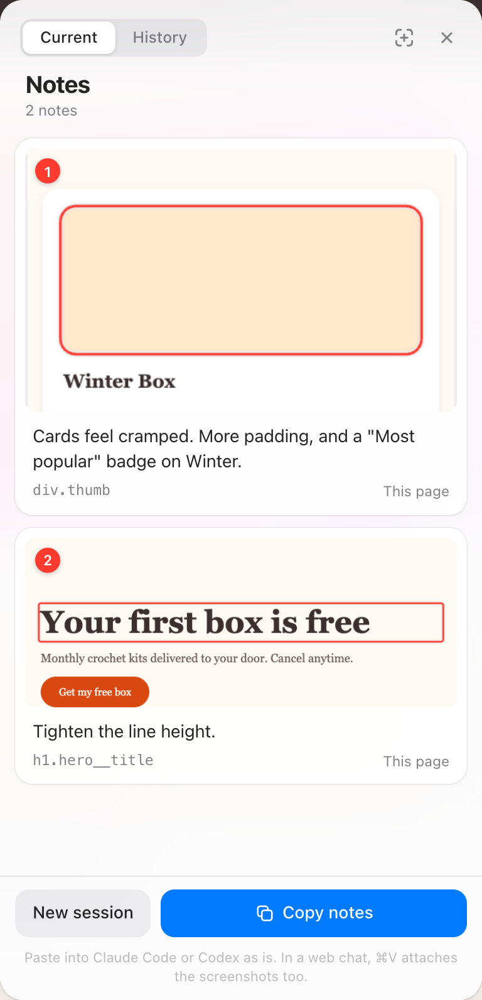
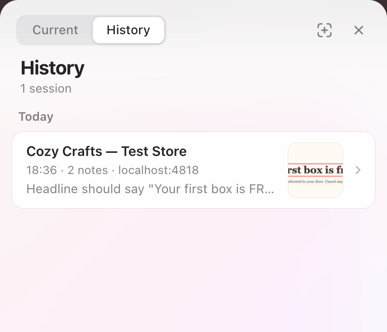

<p align="center">
  
</p>

<h1 align="center">Redline</h1>

<p align="center">
  <strong>Point at anything on a web page, say what should change, and hand the whole batch to your coding agent.</strong>
</p>

<p align="center">
  <a href="LICENSE"></a>
  
  
  
</p>

<p align="center">
  
</p>

Redline is a Chrome extension for UI review. Click an element (or drag an area), type what should change, and move on to the next thing. When you're done, one click copies the whole session as a single, structured prompt: every note paired with its screenshot and the element's location in the DOM. Paste it into Claude Code, Codex, Cursor or a web chat and the agent knows exactly what you meant.

It replaces the usual loop of screenshot → switch to the chat → paste → describe → switch back, where nothing ties a note to its image.

## Features

- **Point and note.** Hover highlights elements the way DevTools does. Click to capture one, drag for an area, <kbd>Space</kbd> for the whole screen. The note field opens right beside what you picked.
- **Screenshots with context.** Element shots include some surrounding page, with the target outlined in red so it's clear what you meant.
- **Prompts agents can act on.** Every note carries the page, viewport and a readable element path that stops at the nearest id. On Shopify that's the section, so the agent can go straight to the right file.
- **Paste anywhere.** Coding agents get local file paths. In web chats, <kbd>⌘</kbd><kbd>V</kbd> attaches the screenshots themselves, each numbered to match its note.
- **Hover states stay live.** Open menus, tooltips and modals (native `<dialog>` included) can be captured while they're open.
- **Works inside iframes**, including cross-origin ones like embedded apps in Shopify admin or the theme editor preview.
- **No duplicates.** While you pick, anything you've already noted turns red and shows its note.
- **Sessions and History.** A session can span tabs and pages. Copying archives it, and your last 50 sessions stay in History to copy again or continue.
- **Private by design.** No accounts, no servers, no analytics. Nothing leaves your machine.

<p align="center">
  &nbsp;&nbsp;
  
</p>

## Install

Redline isn't on the Chrome Web Store. Install it from a release:

1. Download `redline-<version>.zip` from the [latest release](https://github.com/NikaBarbakadze/Redline/releases/latest) and unzip it into a folder you'll keep. Chrome runs it from there.
2. Open `chrome://extensions` and turn on **Developer mode**.
3. Click **Load unpacked** and select the unzipped folder.
4. Pin Redline from the puzzle-piece menu.

To update, replace the files in that folder with the new release's and click reload on Redline's card at `chrome://extensions`. Keep the folder where it is: Chrome ties Redline's notes, History and shortcut to its location. You can also load a clone of this repository the same way.

A welcome page opens with your shortcut and a card to practice on. If <kbd>⌘</kbd><kbd>⇧</kbd><kbd>S</kbd> doesn't trigger Redline, another extension probably owns it. Pick a different one at `chrome://extensions/shortcuts`.

## Usage

Press <kbd>⌘</kbd><kbd>⇧</kbd><kbd>S</kbd>, pick something, write a note and press <kbd>↵</kbd>. Repeat. When you're done, click **Copy notes** in the dock and paste.

| Key | Action |
|---|---|
| <kbd>⌘</kbd><kbd>⇧</kbd><kbd>S</kbd> | Start capturing |
| The toolbar icon | Open or close the notes panel |
| Click | Capture the highlighted element |
| Drag | Capture an area |
| <kbd>Space</kbd> | Capture the whole visible screen |
| <kbd>↑</kbd> / <kbd>↓</kbd> | Select the parent element / go back to the child |
| <kbd>↵</kbd> | Save the note |
| <kbd>⌘</kbd><kbd>↵</kbd> | Save and capture the next one |
| <kbd>⇧</kbd><kbd>↵</kbd> | New line |
| <kbd>esc</kbd> | Cancel (twice if you've typed something) |
| <kbd>esc</kbd> with nothing open | Hide the dock until your next capture |

On Windows and Linux, use <kbd>Ctrl</kbd> wherever you see <kbd>⌘</kbd>.

**The dock** in the corner shows how many notes you have and has **Copy notes**. Click the count (or the toolbar icon) to open the **notes panel**, where you can edit notes inline, zoom screenshots, copy a single screenshot, jump back to a note's element on the page, or delete a note (with undo). Click anywhere outside it, or press <kbd>esc</kbd>, to close it; the dock goes with it until your next capture. The panel follows you across tabs.

**Sessions.** Copying closes the session. It moves to History and your next note starts again at 1, so batches never mix. Copied too early? **Keep adding** in the confirmation toast reopens it. **History** (the second tab in the panel, or right-click the toolbar icon) keeps your last 50 sessions. Open one to copy it again or **Continue** it.

## What gets copied

Screenshots are saved to `~/Downloads/Redline/<session>/01.png, 02.png, …` and the clipboard gets a prompt like this:

```markdown
# UI changes (2 notes)

I took these while reviewing the page in the browser. Each note pairs a screenshot with the change I want. The screenshots are local PNG files; open each one before making its change. In element screenshots the target is outlined in red.

Page: Spring Collection (https://shop.example.com/pages/spring)
Viewport: 1440×900

## 1
Screenshot: /Users/you/Downloads/Redline/2026-10-12_14-32-05/01.png
Element: `section#shopify-section-template--1234__hero > div.hero__content > a#cta` "Shop the collection"
Change: Make the button bigger and use our brand green.

## 2
Screenshot: /Users/you/Downloads/Redline/2026-10-12_14-32-05/02.png
Area: a dragged region centered on `section.grid > div.card.product-card`
Change: Cards feel cramped. Add more padding.
```

Page, viewport and iframe details are only repeated per note when they differ.

### Where to paste

| Destination | What happens |
|---|---|
| **Claude Code, Codex, Cursor** and other coding agents | Paste as is. They open the screenshots from the file paths. |
| **Web chats** (claude.ai, ChatGPT, Codex on the web, …) | <kbd>⌘</kbd><kbd>V</kbd> attaches every screenshot, numbered in its corner, and rewords the prompt to "attached image N". Redline only does this for text it copied itself, so your other pastes are untouched. |
| **Desktop chat apps** | **Show files** in the "Copied" toast opens the screenshots in Finder so you can drag them in. You can also copy a single screenshot from its card in the panel. |

To paste just the text, use **Paste and Match Style** (<kbd>⌥</kbd><kbd>⇧</kbd><kbd>⌘</kbd><kbd>V</kbd>, or <kbd>Ctrl</kbd><kbd>Shift</kbd><kbd>V</kbd>).

## Privacy and permissions

Redline has no backend and makes no network requests ([privacy policy](PRIVACY.md)). Notes and screenshots stay in the extension's local storage, and the only files it writes are the screenshots it saves to your Downloads folder when you copy.

| Permission | Why |
|---|---|
| Access to all sites, `activeTab`, `scripting` | Run the picker on whatever page you're reviewing, including inside its iframes, and capture the visible tab. `scripting` adds Redline to tabs that were already open when it was installed or updated. |
| `storage`, `unlimitedStorage` | Keep the current session, and keep screenshots and History in IndexedDB without hitting the default quota. |
| `downloads`, `downloads.ui` | Save the screenshots as PNGs without the download bubble, then clear their rows from the downloads list. |
| `clipboardWrite`, `offscreen` | Copy the prompt, with an offscreen document as a fallback when the page can't write to the clipboard. |
| `contextMenus` | The right-click menu on the toolbar icon (Capture, History, Copy, New session, Change shortcut). |

## How it works

No build step and no runtime dependencies: plain JavaScript on Manifest V3.

| File | Role |
|---|---|
| `src/content.js` | All in-page UI (picker, composer, dock, notes panel) in a shadow root, so page styles can't leak in. It runs in every frame: child frames pick on their own and post the result up, offset by each `<iframe>`'s content box, until the top frame takes the screenshot, crops it and outlines the target. The top frame draws every drag box, so an area can be dragged across an iframe's edge either way. The UI is a manual popover, so it sits in the top layer above the page's own modals. When a modal `<dialog>` is open, Redline moves inside it so it isn't made inert. While idle, it costs one storage read and a pointer listener. |
| `src/background.js` | The service worker. Captures the tab, stores screenshots and History in IndexedDB (only the active session lives in `chrome.storage`, so tabs stay in sync without passing megabytes of base64 around), writes the PNGs, builds the prompt and numbers the images for web-chat pastes. |
| `src/offscreen.*` | Clipboard fallback. |
| `welcome.html` | First-run page with a practice card. |

## Development

```sh
git clone https://github.com/NikaBarbakadze/Redline.git
```

Load the folder as an unpacked extension (see [Install](#install)). After editing, click reload on Redline's card at `chrome://extensions` and refresh any open tabs.

### Tests

End-to-end suites run a real Chromium with the extension loaded, driven by Playwright. They run against mock pages in `tests/site`: a storefront, a Shopify-admin-style page with a cross-origin app iframe, and mock chat composers.

```sh
cd tests
npm install                              # installs playwright-core
npx playwright-core install chromium     # first run only, if Chromium is missing
npm test                                 # every suite (a few minutes)
node pages.mjs                           # or a single suite
```

`npm run icons` (from `tests/`) re-renders the icons from `tools/make-icons.mjs`.

### Releasing

`./tools/package.sh` builds `redline-<version>.zip` for the Chrome Web Store with only the files the extension loads. `REDLINE_EXT=<unzipped folder> npm test` runs the suites against that build. `store/LISTING.md` has the listing text and the privacy answers, and `node tools/store-shots.mjs` re-renders the store screenshots.

## Contributing

Issues and pull requests are welcome. For anything bigger than a small fix, please open an issue first to talk it through. Before sending a change, run `npm test` in `tests/`. If you fix a bug or change behavior, add a check to the relevant suite.

## License

[MIT](LICENSE)
